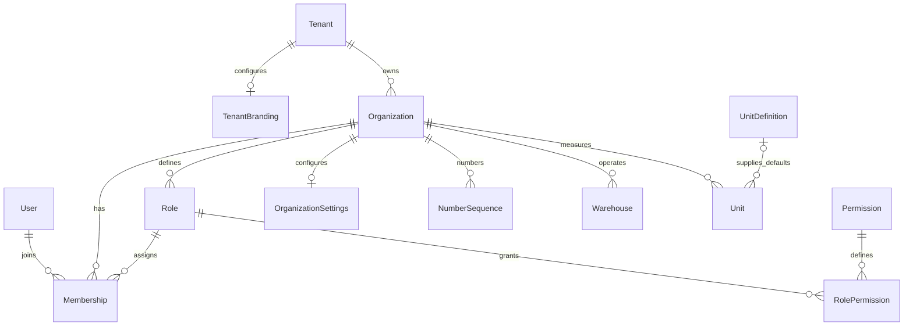
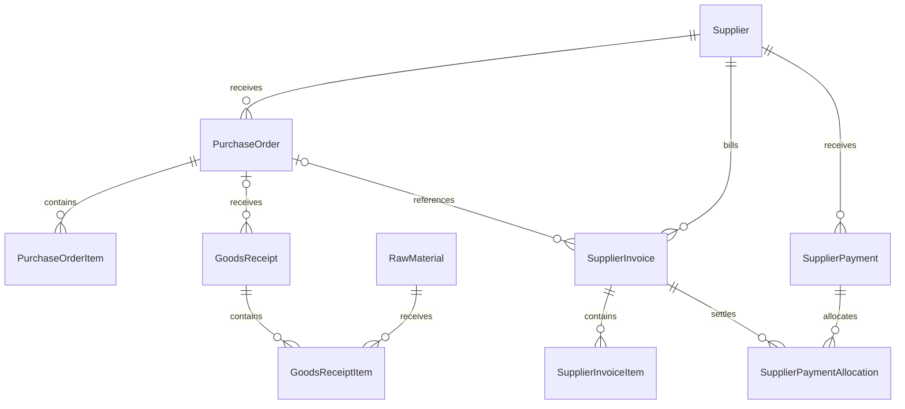
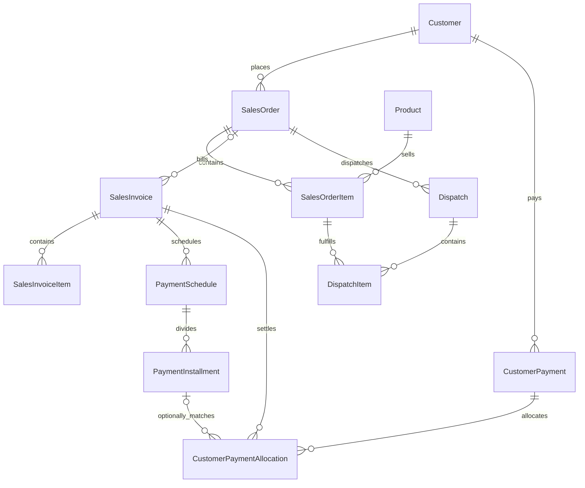
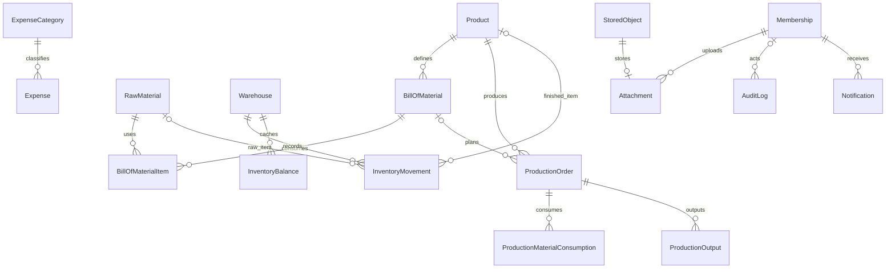

# Factory database ERD

The [generated complete ERD](schema.erd.mmd) contains all 50 models, scalar fields,
and concrete foreign keys. Regenerate it with `npm run erd:generate`. The diagrams
below group the principal relationships; organization scope keys and actor links
apply to every business entity, including child rows.

Every organization-owned relationship includes `(tenantId, organizationId)`.
Payment/invoice references additionally match the counterparty; receipt/dispatch
lines match their parent order/item; production references match the product.
Attachment's polymorphic business target is validated by SQL. Audit and inventory
history are append-only. Derived balance/availability views do not introduce new
financial sources of truth. See [database decisions](database.md) for constraints
and remaining transactional workflow responsibilities.
